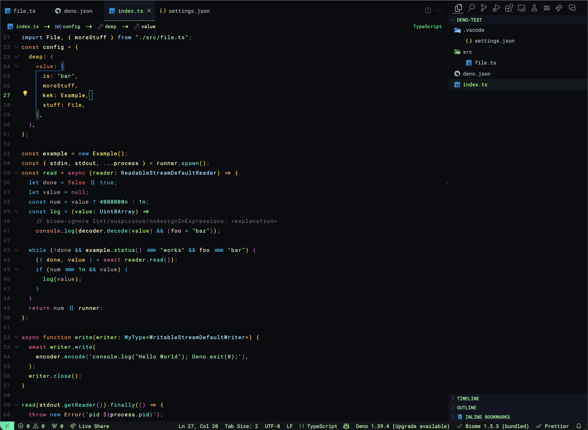
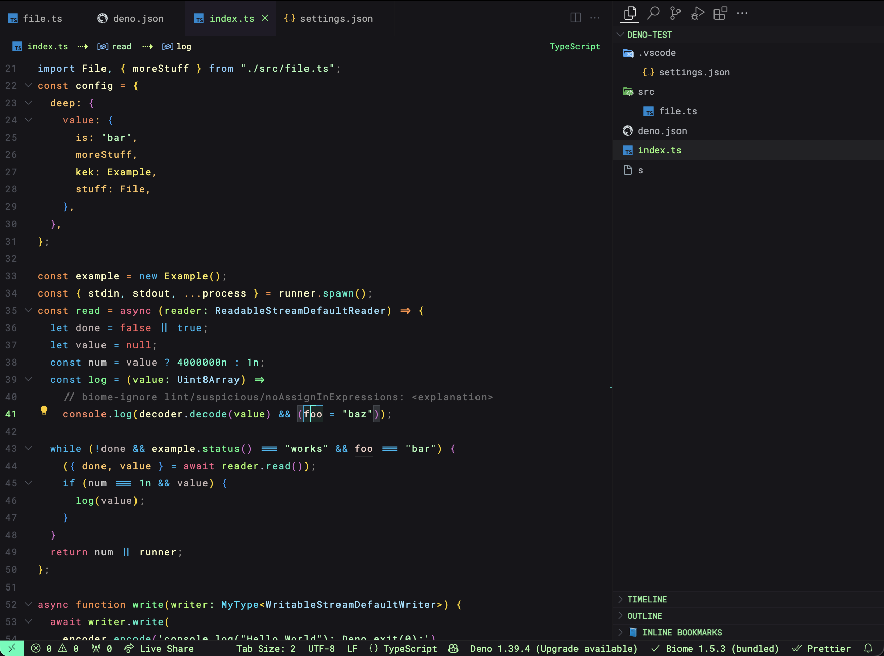
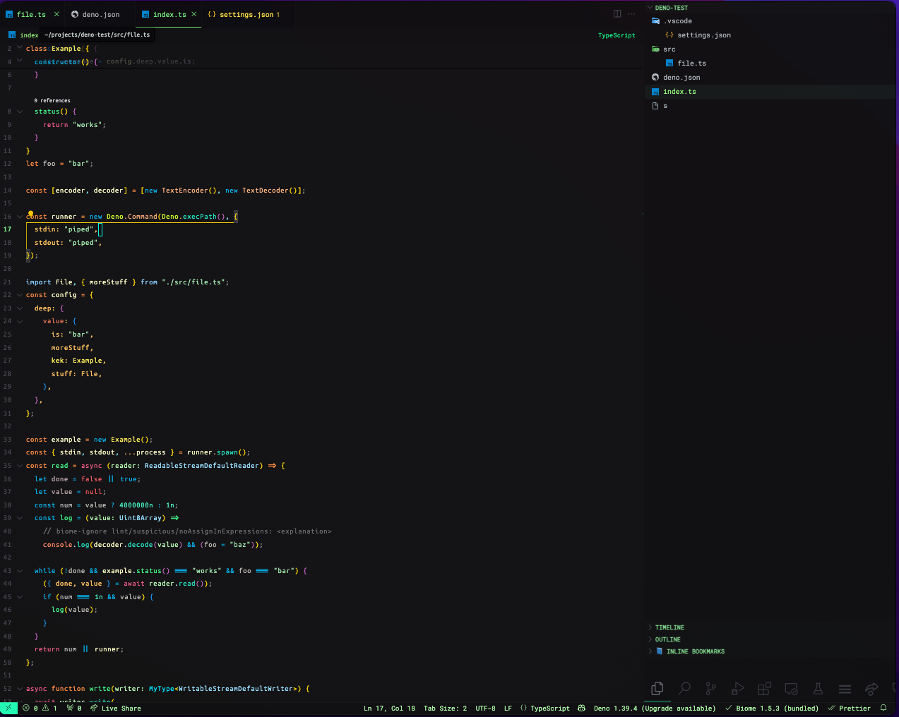

# overload vscode theme

## A vibrant theme for VSCode (best with Solidity/TypeScript)

- For full Solidity semantic highlighting you need [vsc-solidity](https://marketplace.visualstudio.com/items?itemName=0xp.vsc-solidity)
- Optional: the UI font, breadcrumbs styling and macOS window vibrancy need [Custom UI Style](https://marketplace.visualstudio.com/items?itemName=subframe7536.custom-ui-style), see [below](#optional-ui-tweaks-custom-ui-style)

### Default Colors



### Alt Colors



### Vibrancy



### More palettes

Eleven variants that step away from the green accent. Each comes as a regular and a `borderless` theme, like the ones above.

- **overload ember**: warm charcoal chrome with an ember-orange accent, but the code uses the whole wheel: keywords rust / ember / gold, types teal / sky, functions lime / aqua, bindings ivory / rose / cream, members lavender / amber / coral, literals olive / mauve.
- **overload graphite**: polished graphite and neon ink. Cool slate-black, code in ice blue, periwinkle, violet and mint with coral keywords and amber classes.
- **overload violet**: night orchid. Plum-black with a violet cast, code in orchid, iris, lilac and glacier cyan with honey and apricot as the warm counterpoint.
- **overload abyss**: deep sea. A teal-navy background with real color in it, pale cyan-grey text, functions neon turquoise, keywords coral / salmon, types gold, strings seafoam, numbers magenta.
- **overload solar**: sunset neon on a dark neutral. Functions tangerine, keywords magenta / red-pink, types cyan, classes lemon, strings soft rose, numbers violet.
- **overload pink**: dark, pink and white. Hot pink is the hero and goes on function calls and declarations, so `describe()` / `it()` / `expect()` carry a test file. Keywords and types are the whites (cream and lilac-white), identifiers quiet greys, strings a saturated coral, members blush / salmon-rose.
- **overload blush**: dark, pink and white, the warm take. Rose-tinted charcoal, warm cream whites, dusty rose on function calls, violet-lilac strings, blush / salmon members.
- **overload fuchsia**: dark, pink and white, the cold take. Near-black with a faint violet cast, icy whites, fuchsia on function calls, sky strings, pink-white / rose members.
- **overload ocean**: in the mold of Material's Deep Ocean. Deep navy-black, blue-grey text, periwinkle-blue functions, purple keywords, red control flow, yellow types, green strings, orange numbers, cyan accent.
- **overload primer**: GitHub Dark lineage. The navy-black with a darker side bar, coral keywords, pink control flow, purple functions, orange types, light-blue strings, blue constants, green tags, blue accent.
- **overload geist**: Vercel lineage. True neutral black and greys, near-white text, blue functions, pink keywords, purple control flow, teal strings, amber types, lemon classes.

Each semantic family (keywords, types, callables, bindings, members, literals, markup) gets its own hue, and the related roles are derived as shades of the family base so the information is in the shade, not in a random extra color: a function call, a method, a library method like `forEach` and a function-valued variable are four shades of one hue; a type, a library type, a generic and a struct are four shades of another; `new` is a lighter shade of the electric blue that block-level `const` uses, `from` a lighter shade of `import`, modifiers and operators shades of the keyword color. Declarations are a step brighter than usages. Two things carry over from the original overload look in all four: the electric blue on the structural keyword family (block-level `const`, `if`, comparisons, `new`, primitive types, enums) and chroma pushed to the edge of the gamut on functions, keywords, strings and classes.

All of them are generated from OKLCH palettes in [scripts/build-themes.mjs](scripts/build-themes.mjs); edit the palette and run `npm run build` to regenerate the generated JSON files. `npm run audit` checks every palette for low-contrast roles and roles that sit too close in color.

### Default settings

Installing the theme sets these editor defaults (you can override any of them in your own `settings.json`):

- [Ubuntu Mono & Roboto Mono](https://github.com/lemeb/a-better-ligaturizer/tree/master/output-fonts) as editor / terminal fonts, just replace with whatever you like.
- Font sizes, line height, zoom level, tree indent, activity bar at the bottom, minimap off, [Material Icon Theme](https://marketplace.visualstudio.com/items?itemName=PKief.material-icon-theme) icons, etc. See `configurationDefaults` in [package.json](package.json) for the full list.

### Optional UI tweaks (Custom UI Style)

Earlier versions used the APC Customize UI++ extension, which no longer works with current VSCode. VSCode has no built-in way to restyle the UI with CSS or change the window itself, so the remaining tweaks (UI font, breadcrumbs styling, diff markers and vibrancy) now use [Custom UI Style](https://marketplace.visualstudio.com/items?itemName=subframe7536.custom-ui-style). It's optional and **patches VSCode's own files**, so read its README first. After editing the settings, run `Custom UI Style: Reload` from the command palette.

_settings.json_

```json
{
	"custom-ui-style.font.sansSerif": "Roboto Mono",
	"custom-ui-style.font.monospace": "Ubuntu Mono",
	"custom-ui-style.stylesheet": {
		".sidebar.right > .composite.title": {
			"position": "absolute"
		},
		".tabs-and-actions-container > .inline-tabs-placeholder": {
			"position": "absolute"
		},
		".monaco-scrollable-element.modified-in-monaco-diff-editor.vs": {
			"display": "none"
		},
		".monaco-editor .insert-sign": {
			"color": "#81ff89",
			"opacity": "1 !important",
			"font-weight": "700",
			"margin-left": "3px"
		},
		".monaco-editor .delete-sign": {
			"color": "red",
			"opacity": "1 !important",
			"font-weight": "bold"
		},
		".monaco-breadcrumbs": {
			"font-size": "11px",
			"letter-spacing": "0.2px",
			"font-family": "'Roboto Mono'",
			"font-weight": "400"
		},
		".breadcrumbs-below-tabs": {
			"display": "flex",
			"height": "27px",
			"align-items": "center",
			"justify-content": "center"
		},
		".monaco-breadcrumb-item + .outline-element:has(.outline-element-label) > *": {
			"position": "absolute",
			"right": "15px",
			"color": "#12ff89 !important"
		},
		".monaco-breadcrumb-item + .outline-element:has(.outline-element-label) > .codicon": {
			"display": "none"
		},
		".monaco-breadcrumb-item:has([class*='-file']) > :first-of-type": {
			"color": "#98ff7c !important"
		},
		".monaco-breadcrumb-item:not(:has([class*='-file'])) > .codicon:last-child:before": {
			"display": "flex",
			"align-items": "flex-start",
			"justify-items": "flex-start",
			"content": "'/'",
			"margin": "0 1px 0 1px",
			"font-size": "16px",
			"height": "18px",
			"color": "#95aeb4"
		},
		".monaco-breadcrumb-item:has(.codicon[class*='codicon-symbol'])": {
			"color": "#A1F4AD !important"
		},
		".monaco-breadcrumb-item:has(.codicon[class*='codicon-symbol']):last-of-type": {
			"color": "#FFFFC6 !important"
		},
		".monaco-breadcrumb-item:has(.codicon[class*='codicon-symbol']):before": {
			"margin": "0 9px 0 9px",
			"min-width": "20px",
			"margin-top": "1.5px",
			"height": "25px !important",
			"display": "flex",
			"align-items": "flex-start",
			"content": "'⇢'",
			"font-size": "17px",
			"color": "#CBff7b !important"
		},
		".monaco-breadcrumb-item:has([class*='codicon-symbol']) > .codicon:last-child:before": {
			"content": "''"
		},
		".monaco-breadcrumb-item:has([class*='-file']) .codicon:last-child:before": {
			"content": "' '"
		}
	}
}
```

#### Vibrancy themes (macOS)

The `overload vibrancy` themes use translucent backgrounds, so they only look right when the window itself is transparent. Add this too:

```json
{
	"custom-ui-style.electron": {
		"opacity": 0.97,
		"frame": false,
		"transparent": true,
		"vibrancy": "hud",
		"visualEffectState": "active"
	}
}
```

`"frame": false` hides the native title bar and traffic light buttons. Remove it if you want to keep them.
