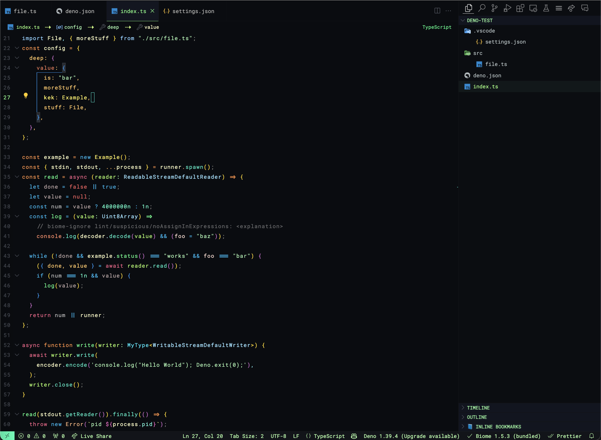
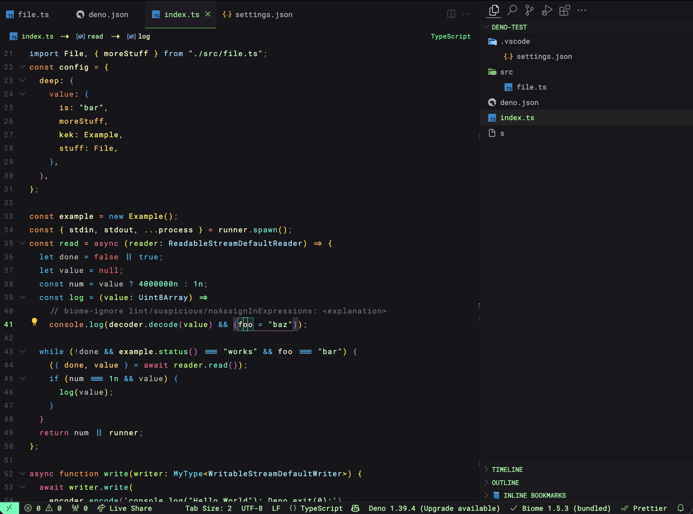
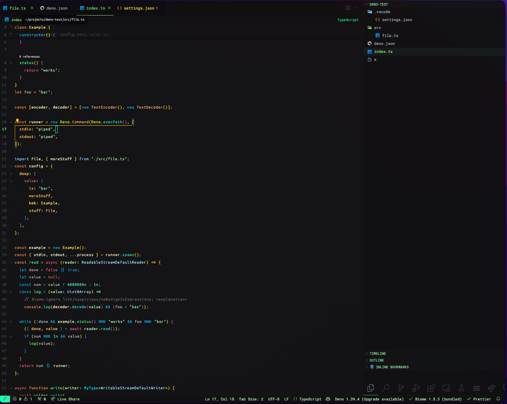

# overload vscode theme

## A vibrant theme for VSCode (best with Solidity/TypeScript)

- For full Solidity semantic highlighting you need [vsc-solidity](https://marketplace.visualstudio.com/items?itemName=0xp.vsc-solidity)
- Optional: the UI font, breadcrumbs styling and macOS window vibrancy need [Custom UI Style](https://marketplace.visualstudio.com/items?itemName=subframe7536.custom-ui-style), see [below](#optional-ui-tweaks-custom-ui-style)

### Default Colors



### Alt Colors



### Vibrancy



### More palettes

Eleven variants that step away from the green accent. Each comes as a regular and a `borderless` theme, like the ones above.

- **overload ember**: warm charcoal with an ember-orange accent. Closest to the original: orange keywords, red-pink control flow, sky branches, lime functions, teal types, yellow classes, rose strings.
- **overload graphite**: polished graphite and neon ink. Cool slate-black, coral keywords, pink control flow, violet functions, ice types, lemon classes, green strings.
- **overload violet**: night orchid. Plum-black with a violet cast, orchid keywords, red-pink control flow, aqua functions, sky types, honey classes, apricot strings.
- **overload abyss**: deep sea. A teal-navy background with real color in it, turquoise functions, coral keywords, gold types, magenta keys, seafoam strings.
- **overload solar**: sunset neon on a dark neutral. Tangerine functions, pink keywords, purple control flow, cyan types, lemon classes, rose strings.
- **overload pink**: a near-black with pinks for structure: hot pink keywords, magenta control flow, ice-cyan functions, lilac types, peach-gold strings.
- **overload blush**: the warm pink take. Rose-tinted charcoal, coral-rose functions, gold keywords, magenta control flow, lilac types, green strings.
- **overload fuchsia**: the cold pink take. Near-black with a faint violet cast, fuchsia functions, violet keywords, red control flow, aqua types, green strings.
- **overload ocean**: in the mold of Material's Deep Ocean. Deep navy-black, blue functions, purple keywords, red control flow, teal types, yellow classes, green strings, cyan accent.
- **overload primer**: GitHub Dark lineage. Coral keywords, pink-red control flow, purple functions, amber types, light-blue strings, blue accent.
- **overload geist**: Vercel lineage. True neutral black, blue functions, pink keywords, purple control flow, amber types, lemon classes, green strings.

Every palette follows the same system as the original overload, only the hues change. The syntax colors come from a dozen family hues, and each role is a fixed lightness / chroma step of its family, measured from the original theme:

- keywords split by what they do: declarations (`const`, `function`, `class`) in one hue, control-flow exits (`return`, `throw`, `await`, `async`, `try` / `catch`) in a second, branching (`if`, `for`, `while`, `switch`, `&&`, `===`, `new`, `typeof`, and `const` / `let` inside blocks) in a third. `return` gets lighter inside a function and lighter again in a nested one.
- related things share a hue: a function name, its calls, methods, library functions like `forEach` and the function's parameters are all shades of one color; types, generics and library types another.
- different areas stay apart: the `function` keyword never looks like the function name, strings never share the function hue.
- plain variables are near-neutral and locals inside a function body drop to a muted grey, so calls and signatures stand out. Parameters are italic everywhere, so you can see where a function's inputs are used without another color.
- keywords sit at a deeper lightness than identifiers, and chroma is pushed to the edge of the sRGB gamut; blues and violets are made a little darker so they keep their color.

All of them are generated from OKLCH palettes in [scripts/build-themes.mjs](scripts/build-themes.mjs); edit the palette and run `npm run build` to regenerate the generated JSON files. `npm run audit` checks every palette for low-contrast roles, for syntax areas that sit too close in color (keyword vs function name, `return` vs `if`, strings vs calls) and for related roles that drift apart, with the original overload hues as the reference.

### Default settings

Installing the theme sets these editor defaults (you can override any of them in your own `settings.json`):

- [Ubuntu Mono & Roboto Mono](https://github.com/lemeb/a-better-ligaturizer/tree/master/output-fonts) as editor / terminal fonts, just replace with whatever you like.
- Font sizes, line height, zoom level, tree indent, activity bar at the bottom, minimap off, [Material Icon Theme](https://marketplace.visualstudio.com/items?itemName=PKief.material-icon-theme) icons, etc. See `configurationDefaults` in [package.json](package.json) for the full list.

### Optional UI tweaks (Custom UI Style)

Earlier versions used the APC Customize UI++ extension, which no longer works with current VSCode. VSCode has no built-in way to restyle the UI with CSS or change the window itself, so the remaining tweaks (UI font, breadcrumbs styling, diff markers and vibrancy) now use [Custom UI Style](https://marketplace.visualstudio.com/items?itemName=subframe7536.custom-ui-style). It's optional and **patches VSCode's own files**, so read its README first. After editing the settings, run `Custom UI Style: Reload` from the command palette.

_settings.json_

```json
{
  "custom-ui-style.font.sansSerif": "Roboto Mono",
  "custom-ui-style.font.monospace": "Ubuntu Mono",
  "custom-ui-style.stylesheet": {
    ".sidebar.right > .composite.title": {
      "position": "absolute"
    },
    ".tabs-and-actions-container > .inline-tabs-placeholder": {
      "position": "absolute"
    },
    ".monaco-scrollable-element.modified-in-monaco-diff-editor.vs": {
      "display": "none"
    },
    ".monaco-editor .insert-sign": {
      "color": "#81ff89",
      "opacity": "1 !important",
      "font-weight": "700",
      "margin-left": "3px"
    },
    ".monaco-editor .delete-sign": {
      "color": "red",
      "opacity": "1 !important",
      "font-weight": "bold"
    },
    ".monaco-breadcrumbs": {
      "font-size": "11px",
      "letter-spacing": "0.2px",
      "font-family": "'Roboto Mono'",
      "font-weight": "400"
    },
    ".breadcrumbs-below-tabs": {
      "display": "flex",
      "height": "27px",
      "align-items": "center",
      "justify-content": "center"
    },
    ".monaco-breadcrumb-item + .outline-element:has(.outline-element-label) > *": {
      "position": "absolute",
      "right": "15px",
      "color": "#12ff89 !important"
    },
    ".monaco-breadcrumb-item + .outline-element:has(.outline-element-label) > .codicon": {
      "display": "none"
    },
    ".monaco-breadcrumb-item:has([class*='-file']) > :first-of-type": {
      "color": "#98ff7c !important"
    },
    ".monaco-breadcrumb-item:not(:has([class*='-file'])) > .codicon:last-child:before": {
      "display": "flex",
      "align-items": "flex-start",
      "justify-items": "flex-start",
      "content": "'/'",
      "margin": "0 1px 0 1px",
      "font-size": "16px",
      "height": "18px",
      "color": "#95aeb4"
    },
    ".monaco-breadcrumb-item:has(.codicon[class*='codicon-symbol'])": {
      "color": "#A1F4AD !important"
    },
    ".monaco-breadcrumb-item:has(.codicon[class*='codicon-symbol']):last-of-type": {
      "color": "#FFFFC6 !important"
    },
    ".monaco-breadcrumb-item:has(.codicon[class*='codicon-symbol']):before": {
      "margin": "0 9px 0 9px",
      "min-width": "20px",
      "margin-top": "1.5px",
      "height": "25px !important",
      "display": "flex",
      "align-items": "flex-start",
      "content": "'⇢'",
      "font-size": "17px",
      "color": "#CBff7b !important"
    },
    ".monaco-breadcrumb-item:has([class*='codicon-symbol']) > .codicon:last-child:before": {
      "content": "''"
    },
    ".monaco-breadcrumb-item:has([class*='-file']) .codicon:last-child:before": {
      "content": "' '"
    }
  }
}
```

#### Vibrancy themes (macOS)

The `overload vibrancy` themes use translucent backgrounds, so they only look right when the window itself is transparent. Add this too:

```json
{
  "custom-ui-style.electron": {
    "opacity": 0.97,
    "frame": false,
    "transparent": true,
    "vibrancy": "hud",
    "visualEffectState": "active"
  }
}
```

`"frame": false` hides the native title bar and traffic light buttons. Remove it if you want to keep them.
